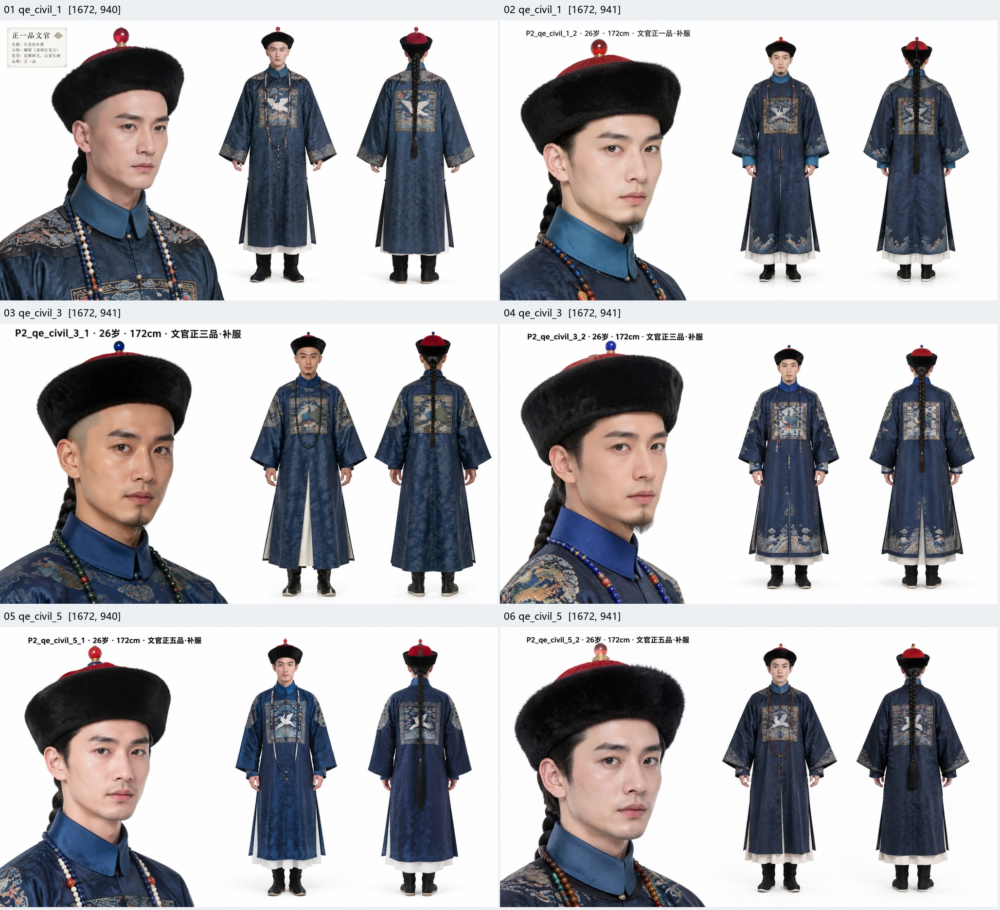
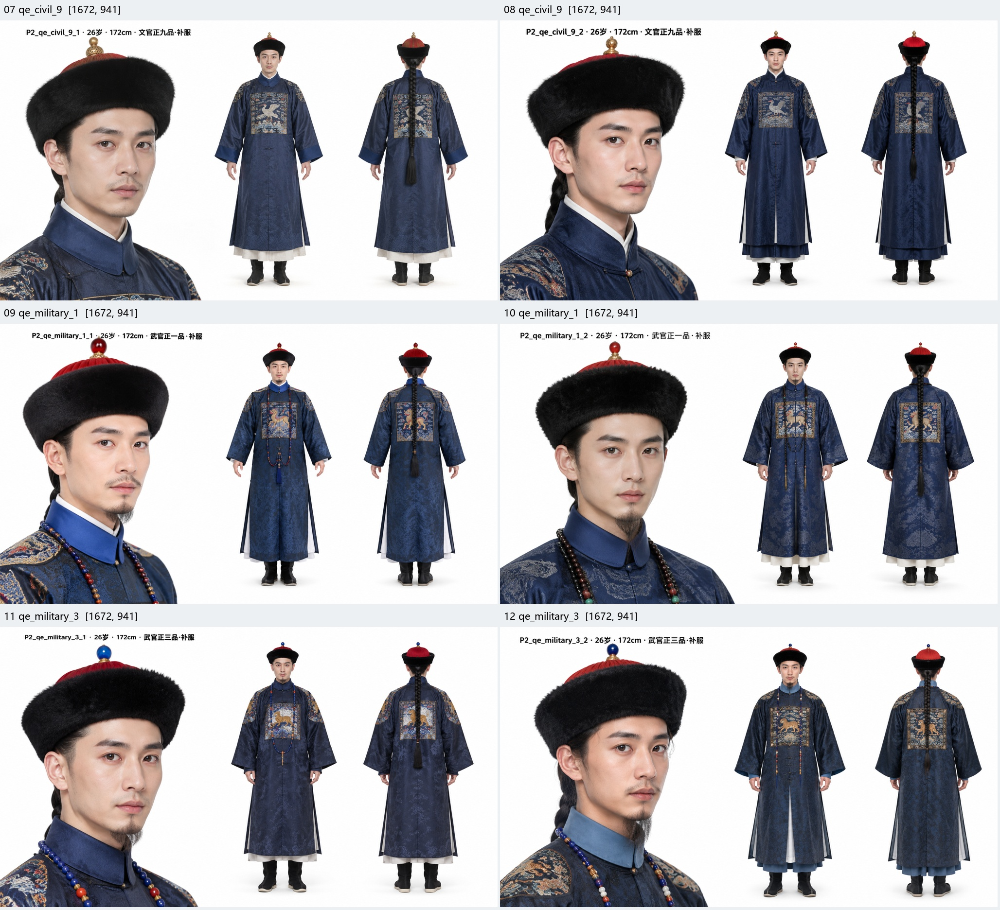
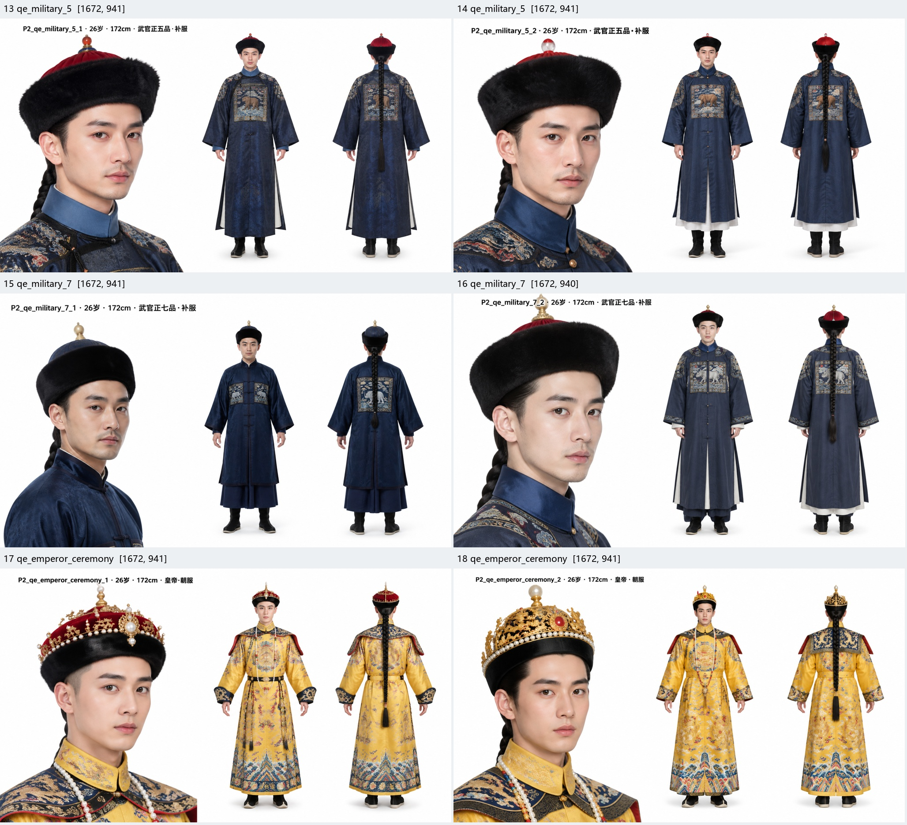
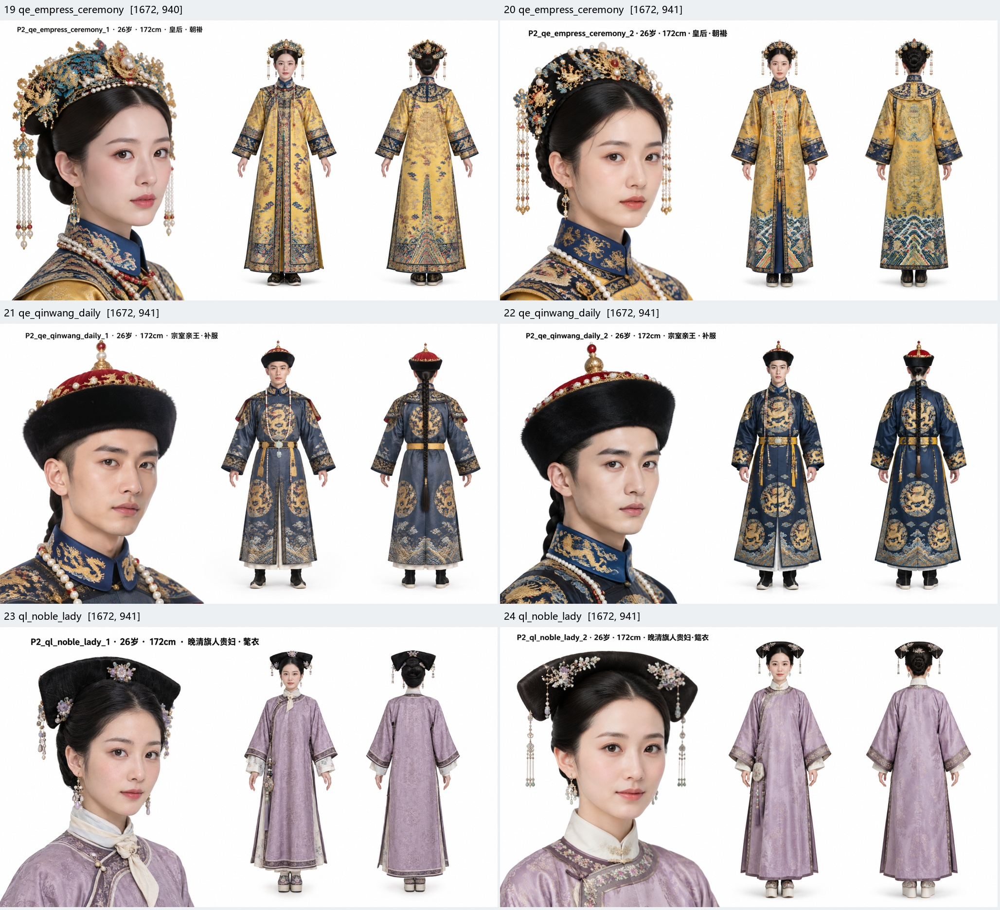
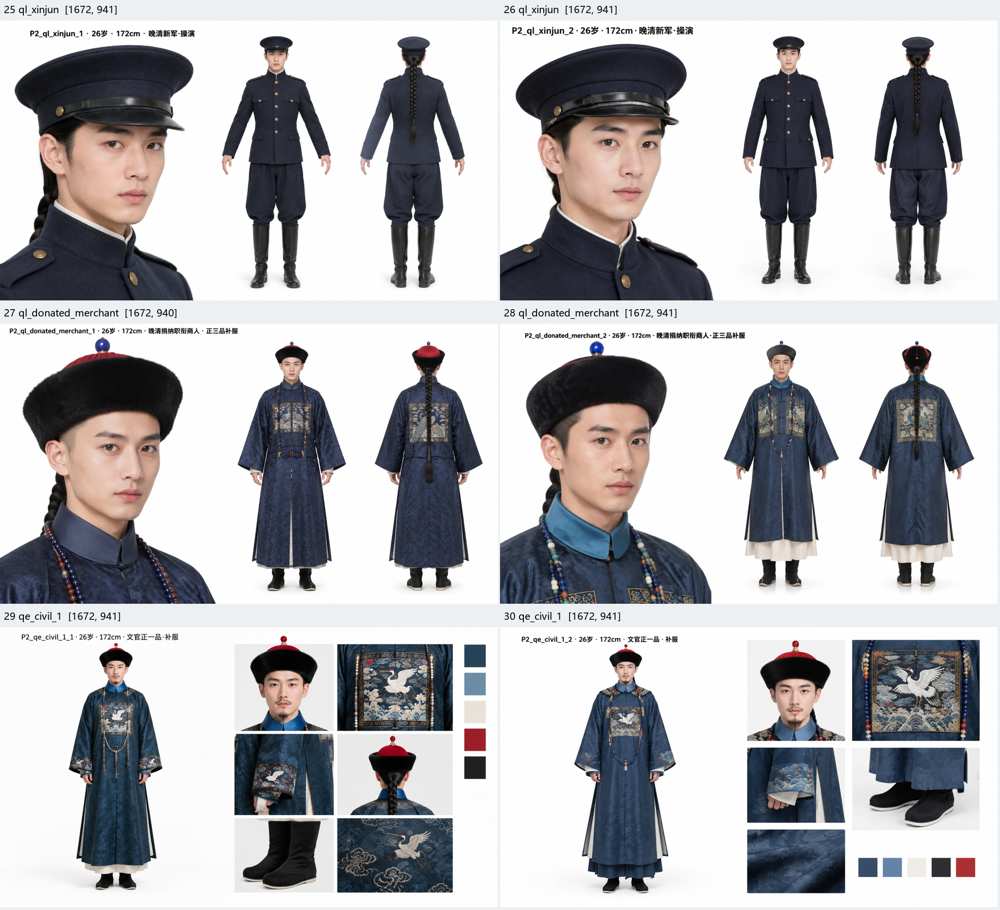

# P2 真实出图验收（2026-10-25）

**结论：请求与落盘30/30；真实2K像素0/30，整体验收未通过。**

视觉初评达到7/10：24/30。三类帝后/亲王均未达到阈值；两张拆解图另有无文字版式失败。分数只是下述粗粒度锚点初评，不是专家史实认证。

## 实际执行与版本

- 固定服务商/模型：mlgb7 / gpt-image-2.5-sunburst。单张探针 + 三批10/10/9，全部attempts=1。没有盲重发或额外补图。
- 请求尺寸均为2048×1152；图片解码均为1672×940或1672×941。上游meta.size回显2048×1152不是实际像素证据。
- 首张探针只核对了请求成功和落盘，未先解码像素便继续29张，这是本次执行偏差。现已在验收脚本和服务端存档中增加实际像素检查；不再追加付费请求。
- 本批由8787旧进程执行，30份实际JSON均为schemaVersion=3，30/30保留evidence；新代码假上游E2E验证schemaVersion=4及actualSize。未重写旧JSON或伪称这些图使用了修订后皇后/新军/拆解模板。
- 图片、JSON、promptHash、人物参数、prompt、请求模型与时间保留在原输出目录。机器清单见[P2-live-manifest.json](P2-live-manifest.json)。
- 总样本是15组×2张：文官1/3/5/9；武官1/3/5/7；皇帝、皇后、亲王、晚清旗女、新军、捐纳商人、文一品拆解。原计划文字同时列15组和多于15组候选，执行固定30张，没有把文七/武九/学堂冒充为已真实抽检；这些项目仅离线验证。

## 10项评分口径

各项0/1。明确可见符合预设或不适用且未添加错误物件=1；错误、被遮住或分辨率不足无法确认=0。绝不从提示词、文件名或模型绘制的标题给分。顶珠只判可见色相，不能凭图片证明宝石材质；爪数不可辨不给分。

|位序|锚点|
|---|---|
|1|身份与场合组合|
|2|首服外形|
|3|方补/团纹种类及位置；非官无僭用|
|4|顶珠色相/冠顶层级；非官无错误顶戴|
|5|朝珠资格和串数；不适用无误配|
|6|袖口、开衩和衣层|
|7|发制：无法看清剃额等要求不得推测|
|8|鞋履形制|
|9|主色与材质外观（非材料鉴定）|
|10|无时代冲突；拆解图另检查无文字约束|

## 逐图记录

|编号|身份卡/画幅|实际像素|10项0/1|总分|视觉阈值|问题与归因|图片 / JSON|
|---|---|---|---|---|---|---|---|
|01|qe_civil_1/sheet_2view|1672×940|1111110111|9/10|≥7|方补可辨为长颈白鹤；帽顶红色、珠链可见。前额剃发被帽遮住无法确认。|[图](../../output/人物/男/004_P2探针_文官正一品_178cm_正背设定卡.png) / [JSON](../../output/人物/男/004_P2探针_文官正一品_178cm_正背设定卡.json)|
|02|qe_civil_1/sheet_2view|1672×941|1111110111|9/10|≥7|正背均有白鹤方补；红顶与珠链可见。前额剃发不清。|[图](../../output/人物/男/008_P2_02_qe_civil_1_2_正背设定卡.png) / [JSON](../../output/人物/男/008_P2_02_qe_civil_1_2_正背设定卡.json)|
|03|qe_civil_3/sheet_2view|1672×941|1100110111|7/10|≥7|方补禽纹难判孔雀；大头像帽顶偏红，未稳定体现蓝顶。|[图](../../output/人物/男/010_P2_03_qe_civil_3_1_正背设定卡.png) / [JSON](../../output/人物/男/010_P2_03_qe_civil_3_1_正背设定卡.json)|
|04|qe_civil_3/sheet_2view|1672×941|1101110111|8/10|≥7|帽顶蓝色；方补禽纹不能确认孔雀，前额剃发不可判。|[图](../../output/人物/男/005_P2_04_qe_civil_3_2_正背设定卡.png) / [JSON](../../output/人物/男/005_P2_04_qe_civil_3_2_正背设定卡.json)|
|05|qe_civil_5/sheet_2view|1672×940|1100110111|7/10|≥7|五品应白鹇，实画长颈白鹤；水晶顶被画红色。已看原图。|[图](../../output/人物/男/006_P2_05_qe_civil_5_1_正背设定卡.png) / [JSON](../../output/人物/男/006_P2_05_qe_civil_5_1_正背设定卡.json)|
|06|qe_civil_5/sheet_2view|1672×941|1100110111|7/10|≥7|五品同样偏鹤纹与红顶；不能以人物标题上的品级判合格。|[图](../../output/人物/男/007_P2_06_qe_civil_5_2_正背设定卡.png) / [JSON](../../output/人物/男/007_P2_06_qe_civil_5_2_正背设定卡.json)|
|07|qe_civil_9/sheet_2view|1672×941|1101110111|8/10|≥7|九品未佩朝珠正确；方补偏白鹤，练雀未落实。|[图](../../output/人物/男/009_P2_07_qe_civil_9_1_正背设定卡.png) / [JSON](../../output/人物/男/009_P2_07_qe_civil_9_1_正背设定卡.json)|
|08|qe_civil_9/sheet_2view|1672×941|1101110111|8/10|≥7|金色顶、无朝珠；禽纹偏鹤，难判练雀。|[图](../../output/人物/男/011_P2_08_qe_civil_9_2_正背设定卡.png) / [JSON](../../output/人物/男/011_P2_08_qe_civil_9_2_正背设定卡.json)|
|09|qe_military_1/sheet_2view|1672×941|1101110111|8/10|≥7|有兽纹方补、红顶与珠链；麒麟角蹄细节不足，不能确认兽种。|[图](../../output/人物/男/014_P2_09_qe_military_1_1_正背设定卡.png) / [JSON](../../output/人物/男/014_P2_09_qe_military_1_1_正背设定卡.json)|
|10|qe_military_1/sheet_2view|1672×941|1101110111|8/10|≥7|兽纹可见，麒麟种类不确认；珠链资格可见。|[图](../../output/人物/男/012_P2_10_qe_military_1_2_正背设定卡.png) / [JSON](../../output/人物/男/012_P2_10_qe_military_1_2_正背设定卡.json)|
|11|qe_military_3/sheet_2view|1672×941|1101110111|8/10|≥7|蓝顶与珠链可见；兽纹斑点不足，不能确认三品豹。|[图](../../output/人物/男/013_P2_11_qe_military_3_1_正背设定卡.png) / [JSON](../../output/人物/男/013_P2_11_qe_military_3_1_正背设定卡.json)|
|12|qe_military_3/sheet_2view|1672×941|1101110111|8/10|≥7|兽纹更像通用大猫，不能确认豹；蓝顶珠链可见。|[图](../../output/人物/男/015_P2_12_qe_military_3_2_正背设定卡.png) / [JSON](../../output/人物/男/015_P2_12_qe_military_3_2_正背设定卡.json)|
|13|qe_military_5/sheet_2view|1672×941|1110110111|8/10|≥7|五品无朝珠符合默认通则；熊形可辨，顶珠偏红不符水晶。|[图](../../output/人物/男/016_P2_13_qe_military_5_1_正背设定卡.png) / [JSON](../../output/人物/男/016_P2_13_qe_military_5_1_正背设定卡.json)|
|14|qe_military_5/sheet_2view|1672×941|1111110111|9/10|≥7|熊形方补、透明浅色顶、无朝珠；前额发制仍无法确认。|[图](../../output/人物/男/017_P2_14_qe_military_5_2_正背设定卡.png) / [JSON](../../output/人物/男/017_P2_14_qe_military_5_2_正背设定卡.json)|
|15|qe_military_7/sheet_2view|1672×941|1111110111|9/10|≥7|犀形方补与金色顶可见、无朝珠；仅验证项目所选犀牛版本，未裁断异说。|[图](../../output/人物/男/018_P2_15_qe_military_7_1_正背设定卡.png) / [JSON](../../output/人物/男/018_P2_15_qe_military_7_1_正背设定卡.json)|
|16|qe_military_7/sheet_2view|1672×940|1111110111|9/10|≥7|同见犀形、金顶与无朝珠；前额发制不明。|[图](../../output/人物/男/020_P2_16_qe_military_7_2_正背设定卡.png) / [JSON](../../output/人物/男/020_P2_16_qe_military_7_2_正背设定卡.json)|
|17|qe_emperor_ceremony/sheet_2view|1672×941|1000100111|5/10|未通过|朝冠层级/东珠无法确认；袍纹爪数不清，朝裳分层不明确。|[图](../../output/人物/男/019_P2_17_qe_emperor_ceremony_1_正背设定卡.png) / [JSON](../../output/人物/男/019_P2_17_qe_emperor_ceremony_1_正背设定卡.json)|
|18|qe_emperor_ceremony/sheet_2view|1672×941|1000100111|5/10|未通过|冠偏演绎式金冠，朝冠层级与朝裳不明；不能据明黄龙袍判典制通过。|[图](../../output/人物/男/021_P2_18_qe_emperor_ceremony_2_正背设定卡.png) / [JSON](../../output/人物/男/021_P2_18_qe_emperor_ceremony_2_正背设定卡.json)|
|19|qe_empress_ceremony/sheet_2view|1672×940|0000001001|2/10|未通过|黄外衣代替石青朝褂；冠式、朝裙/朝袍分层、三盘朝珠均不足。已看原图。|[图](../../output/人物/女/003_P2_19_qe_empress_ceremony_1_正背设定卡.png) / [JSON](../../output/人物/女/003_P2_19_qe_empress_ceremony_1_正背设定卡.json)|
|20|qe_empress_ceremony/sheet_2view|1672×941|0000001001|2/10|未通过|同样黄外层、泛化凤冠；三盘朝珠和分层不足。|[图](../../output/人物/女/004_P2_20_qe_empress_ceremony_2_正背设定卡.png) / [JSON](../../output/人物/女/004_P2_20_qe_empress_ceremony_2_正背设定卡.json)|
|21|qe_qinwang_daily/sheet_2view|1672×941|1000000111|4/10|未通过|团龙重复到下摆，四团位置不稳；冠顶/朝带细节不确认，场合混合。|[图](../../output/人物/男/022_P2_21_qe_qinwang_daily_1_正背设定卡.png) / [JSON](../../output/人物/男/022_P2_21_qe_qinwang_daily_1_正背设定卡.json)|
|22|qe_qinwang_daily/sheet_2view|1672×941|1000000111|4/10|未通过|重复团纹、珠链与腰带混搭；未满足限定四团与场合组合。|[图](../../output/人物/男/023_P2_22_qe_qinwang_daily_2_正背设定卡.png) / [JSON](../../output/人物/男/023_P2_22_qe_qinwang_daily_2_正背设定卡.json)|
|23|ql_noble_lady/sheet_2view|1672×941|1111101011|8/10|≥7|旗头/藕荷衣与盘发可见；开衩未到腋，高底更像双跟，鞋底形制失败。|[图](../../output/人物/女/006_P2_23_ql_noble_lady_1_正背设定卡.png) / [JSON](../../output/人物/女/006_P2_23_ql_noble_lady_1_正背设定卡.json)|
|24|ql_noble_lady/sheet_2view|1672×941|1111101011|8/10|≥7|同样开衩和花盆底位置不准确；不把高跟概念等同花盆底。|[图](../../output/人物/女/005_P2_24_ql_noble_lady_2_正背设定卡.png) / [JSON](../../output/人物/女/005_P2_24_ql_noble_lady_2_正背设定卡.json)|
|25|ql_xinjun/sheet_2view|1672×941|1111100110|7/10|≥7|大檐帽、深蓝制服、长靴可见；帽章/发制/领袖章未核，属D/E演绎。|[图](../../output/人物/男/024_P2_25_ql_xinjun_1_正背设定卡.png) / [JSON](../../output/人物/男/024_P2_25_ql_xinjun_1_正背设定卡.json)|
|26|ql_xinjun/sheet_2view|1672×941|1111100110|7/10|≥7|通用制服外观稳定；不能确认特定晚清军镇年份，时代细部不给分。|[图](../../output/人物/男/026_P2_26_ql_xinjun_2_正背设定卡.png) / [JSON](../../output/人物/男/026_P2_26_ql_xinjun_2_正背设定卡.json)|
|27|ql_donated_merchant/sheet_2view|1672×940|1101110111|8/10|≥7|捐纳标题不是身份实据；蓝顶、珠链可见，但孔雀纹不够明确。|[图](../../output/人物/男/025_P2_27_ql_donated_merchant_1_正背设定卡.png) / [JSON](../../output/人物/男/025_P2_27_ql_donated_merchant_1_正背设定卡.json)|
|28|ql_donated_merchant/sheet_2view|1672×941|1101110111|8/10|≥7|蓝顶、珠链与补褂组合可见；孔雀禽纹不能确认。|[图](../../output/人物/男/027_P2_28_ql_donated_merchant_2_正背设定卡.png) / [JSON](../../output/人物/男/027_P2_28_ql_donated_merchant_2_正背设定卡.json)|
|29|qe_civil_1/costume_breakdown|1672×941|1111100110|7/10|≥7|拆解与色块存在，但有多余人物标题、袖口复制鹤纹、细节数多于五窗。|[图](../../output/人物/男/029_P2_29_qe_civil_1_1_服饰拆解与色卡.png) / [JSON](../../output/人物/男/029_P2_29_qe_civil_1_1_服饰拆解与色卡.json)|
|30|qe_civil_1/costume_breakdown|1672×941|1111100110|7/10|≥7|有五窗与色卡，但仍生成标题文字；不能通过无文字版式验收。|[图](../../output/人物/男/028_P2_30_qe_civil_1_2_服饰拆解与色卡.png) / [JSON](../../output/人物/男/028_P2_30_qe_civil_1_2_服饰拆解与色卡.json)|

## 图像总览

## 已实施的修订与未付费复测项

- 已修：皇后外褂石青/内袍明黄/朝裙/三盘朝珠；晚清移除全局钿子禁项；新军不固定未经校勘的扣数并标D/E；商人品级门控与实际套卡修正；拆解关闭info文字段。
- 上述修订通过离线编译、36卡真实clamp及浏览器测试，但未追加真实付费图，不能把本批旧样本的失败改判成功。
- 仍需服务商解释实际像素缩水；不得在本地放大后宣称原生2K。
- 官员禽兽纹样、冠顶/朝珠、亲王四团位置、旗女花盆底稳定性仍是模型问题，后续如安排重测，应先明确样本和费用。
- A/B只是来源类别。新军/学堂、未核鞋履和顶戴时点的限制见[P2史料核验](P2史料核验-20261025.md)。
